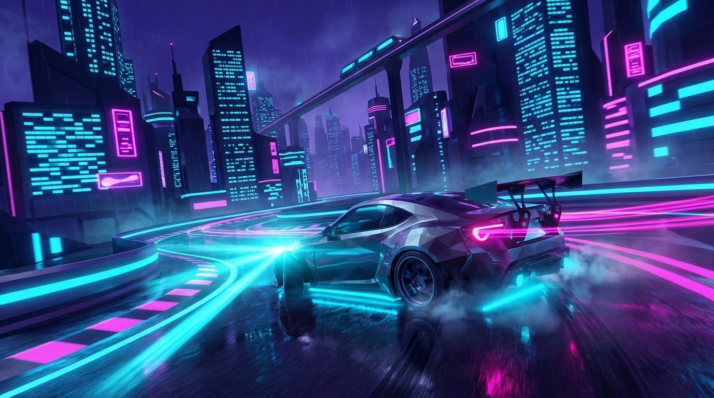
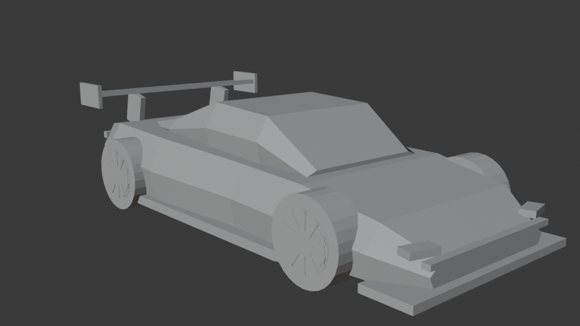
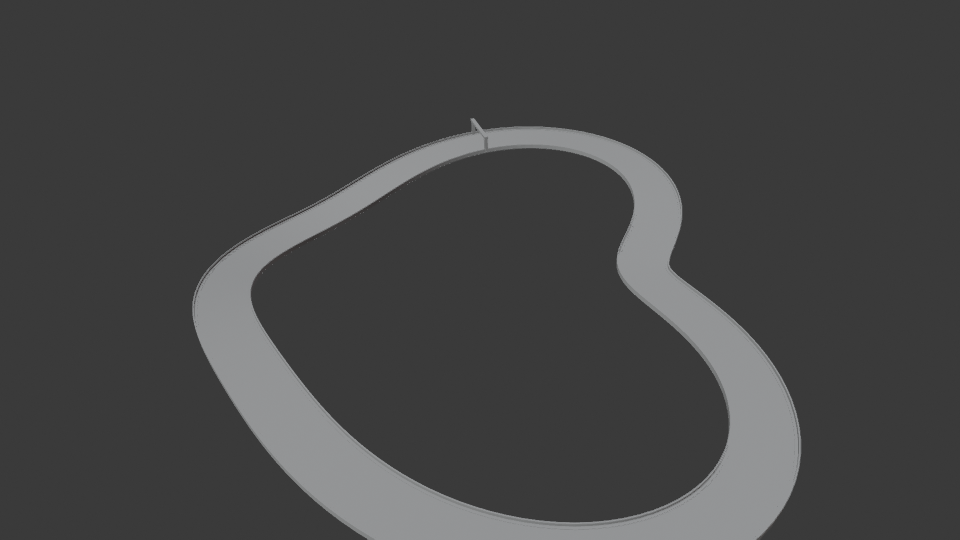

<div align="center">

# ⚡ NEON DRIFT RACER

**A stylized cyberpunk arcade drift circuit racer built with Unity 6 (URP) and Blender 5.3.**


<br/>



</div>

---

## 🎮 Overview

**Neon Drift Racer** is a fast-paced PC desktop arcade drift racer set on a 684-meter closed neon circuit surrounded by a midnight cyberpunk skyline. Built around a *"everything that scores, glows"* art direction, the game pairs custom-sculpted Blender 3D assets with procedural wet-asphalt PBR textures, HDR Bloom post-processing, real-time lateral-slip drift physics, and a procedural audio synthesizer.

---

## ✨ Key Features

- **Real Fishtailing & Lateral-Slip Drift Physics** (`DriftCarController.cs`) — Authentic angular yaw inertia (`yawInertia`) and low drift/handbrake lateral grip let the rear end swing wide into corners, complete with automatic front-wheel counter-steering, Spacebar handbrake kicks, boost pad acceleration, spinning wheels, and suspension pitch/roll.
- **Wet Mirror-Reflective Circuit & Neon Curbs** (`CyberMaterialFactory.cs`, `TrackMeshGenerator.cs`) — Rain-slicked asphalt paired with a **Realtime `ReflectionProbe`**, alternating **Electric Cyan & Hot Magenta** rumble-strip curbs, dual neon-railed barrier walls, 6 checkpoint gantries, 6 chevron boost pads, and an infinite synthwave grid floor.
- **Living Cyberpunk Metropolis & Rain** (`AutoSceneBuilder.cs`) — **72 lit skyscrapers** (outer skyline + inner-circuit towers) with glowing neon windows and vertical billboards, an **elevated monorail skybridge** with a glowing cyan train, atmospheric **falling rain streaks**, URP HDR Bloom, ACES Tonemapping, and a 6-sided synthwave skybox.
- **Underglow, Headlight Beams & Taillight Ribbons** (`DriftVFX.cs`, `AutoSceneBuilder.cs`) — Dual `SpotLight` headlights with additive light-cone beams, bright cyan underglow casting light onto the wet road, sweeping **Hot Magenta taillight light-ribbons**, cyan rear-tire skid trails, and stylized drift smoke.
- **Hero Drift Chase Camera & Procedural Audio** (`CameraRig.cs`, `AudioManager.cs`) — Low-angle chase camera that swings outside the drift to frame the car's side profile and taillight trails, dynamic speed FOV, plus real-time synthesized engine drone, tire screech, boost sweep, checkpoint blips, and retro synth bassline.
- **Cyberpunk HUD & Live Minimap** (`HUDController.cs`) — Glassmorphic neon panels with live speedometer + color-shifting fill bar, lap & best-lap timers, pulsing `DRIFT x1.0–5.0` combo multiplier, and a live circuit minimap.

---

## 🛠️ 3D Asset Previews (Blender 5.3 Pipeline)

All core 3D geometry and track spline waypoints are procedurally modeled and exported to FBX/JSON via [`blender/build_assets.py`](blender/build_assets.py):

| Cyberpunk Drift Car (`NeonDriftCar.fbx`) | 684m Closed Drift Circuit (`NeonTrack.fbx`) |
| :---: | :---: |
|  |  |

### Art Palette (`Palette.cs`)

| Role | Color | Hex |
| :--- | :--- | :--- |
| **Road Asphalt** | Ink Navy | `#111626` |
| **Track Bounds** | Midnight | `#1E2747` |
| **Neon Primary** | Electric Cyan (HDR) | `#00E5FF` |
| **Neon Secondary** | Hot Magenta (HDR) | `#FF2E93` |
| **Score / Finish** | Laser Gold (HDR) | `#FFE14D` |
| **Sky / Void** | Abyss | `#080A14` |

---

## 🧰 Tools & Technologies Used

| Tool / Technology | Version / Package | Role in Project |
| :--- | :--- | :--- |
| **Unity Engine** | `6000.6.11f1` | Core 3D game engine, physics (`Rigidbody`), lighting & build target |
| **Universal Render Pipeline (URP)** | `17.2.6` | HDR rendering, ACES Tonemapping, Bloom, SMAA, Lit/Unlit shaders |
| **Blender** | `5.3.0` | 3D modeling & FBX export (`NeonDriftCar`, `NeonTrack`, `NeonProps`) |
| **Python (`bpy`, `bmesh`, `mathutils`)** | Embedded in Blender | Automated procedural mesh modeling, UV mapping, & waypoint JSON export |
| **C# (.NET / Unity)** | `Assembly-CSharp` | Gameplay physics, procedural textures/audio, VFX, and runtime scene assembly |
| **Unity Input System & TextMeshPro** | `com.unity.inputsystem`, `com.unity.ugui` | Dual-mode keyboard input handling & crisp vector HUD typography |
| **Unity CLI & Pipeline** | `unity` `1.1.0`, `com.unity.pipeline` | Headless project scaffolding, package management, & compilation verification |

---

## 🕹️ Controls

| Key | Action |
| :--- | :--- |
| **`W`** / **`↑`** | Accelerate |
| **`S`** / **`↓`** | Brake / Reverse |
| **`A`** / **`D`** or **`←`** / **`→`** | Steer & Counter-Steer |
| **`Space`** | Handbrake Drift |
| **`Enter`** | Start Race / Restart |
| **`Esc`** | Pause / Resume |

---

## 📁 Project Structure

```text
neon-drift-racer/
├── blender/
│   ├── build_assets.py              # Procedural Blender 3D car, track & props generator
│   ├── NeonDriftCar.blend           # Source Blender file for the drift car
│   ├── NeonTrack.blend              # Source Blender file for the 684m circuit
│   ├── NeonProps.blend              # Source Blender file for gates, boost pads & towers
│   └── exports/                     # Exported FBX models & track_waypoints.json
├── docs/
│   └── images/                      # README hero banner & Blender 3D previews
├── NeonDriftRacer/                  # Unity 6 URP Project
│   ├── Assets/
│   │   ├── Data/                    # track_waypoints.json (180 Unity-space spline points)
│   │   ├── Materials/               # URP PBR & HDR emissive materials
│   │   ├── Models/                  # Imported FBX assets
│   │   ├── Resources/               # Runtime-loaded FBX models & waypoint JSON
│   │   ├── Scenes/                  # SampleScene.unity
│   │   ├── Scripts/
│   │   │   ├── AutoSceneBuilder.cs  # Runtime scene, lighting, post-processing & HUD builder
│   │   │   ├── CyberMaterialFactory.cs # Procedural textures, skybox & FBX material remapper
│   │   │   ├── DriftCarController.cs   # Lateral-slip drift physics & wheel animation
│   │   │   ├── DriftVFX.cs          # Skid trails, tire smoke & boost exhaust trails
│   │   │   ├── TrackMeshGenerator.cs   # Procedural road, neon curbs & barrier mesh builder
│   │   │   ├── CameraRig.cs         # Dynamic chase camera with speed FOV
│   │   │   ├── HUDController.cs     # Speedometer, drift combo & live minimap
│   │   │   ├── AudioManager.cs      # Procedural synth engine, screech & music
│   │   │   ├── GameLoop.cs          # Ready / Countdown / Running / Won / Lost state machine
│   │   │   ├── LapManager.cs        # 6-checkpoint sector & 3-lap timer
│   │   │   ├── CheckpointGate.cs    # Sector trigger handler
│   │   │   ├── BoostPad.cs          # Speed boost trigger pad
│   │   │   ├── TrackWaypoints.cs    # Spline waypoint loader & progress query
│   │   │   ├── Palette.cs           # Single source of truth for Art Bible colors
│   │   │   └── Editor/SceneBuilder.cs # Editor menu builder (NeonDrift > Build Complete Scene)
│   │   └── Settings/                # URP PC/Mobile render pipeline & post-process assets
│   └── Packages/                    # Unity UPM manifest & lockfile
└── .gitignore                       # Ignores Unity Library/Temp/Logs & Blender backups
```

---

## 🚀 Getting Started

1. **Clone the repository:**
   ```bash
   git clone https://github.com/Merdikai/neon-drift-racer.git
   ```
2. **Open in Unity 6:**
   - Launch **Unity Hub** (`6000.6.11f1` or newer).
   - Click **Add → Add project from disk** and select the `NeonDriftRacer/` folder.
3. **Play:**
   - Open `Assets/Scenes/SampleScene.unity` and press **Play (▶️)** — `AutoSceneBuilder` will automatically assemble the circuit, car, lighting, audio, and HUD.
   - *(Optional)* Rebuild Blender assets anytime with:
     ```bash
     blender --background --python blender/build_assets.py
     ```
